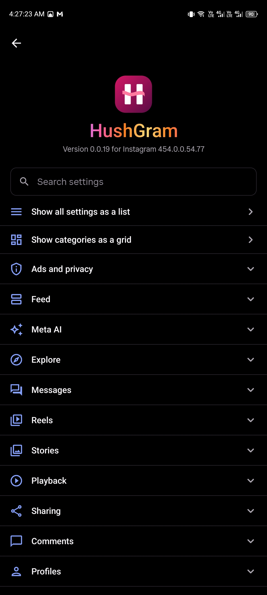
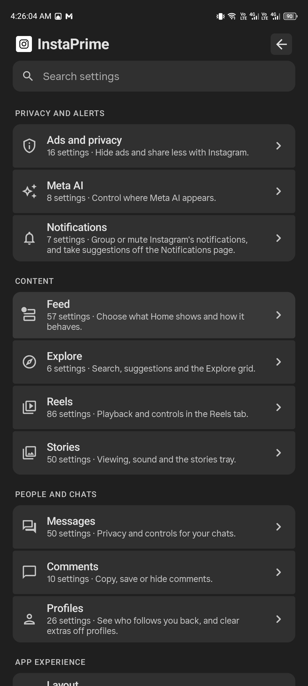
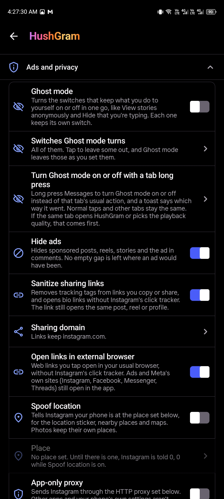
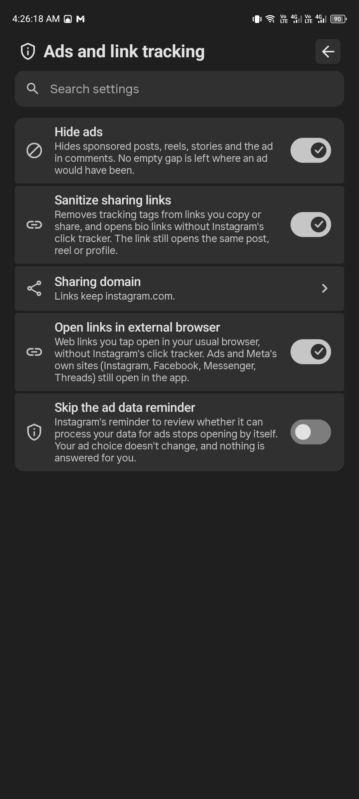
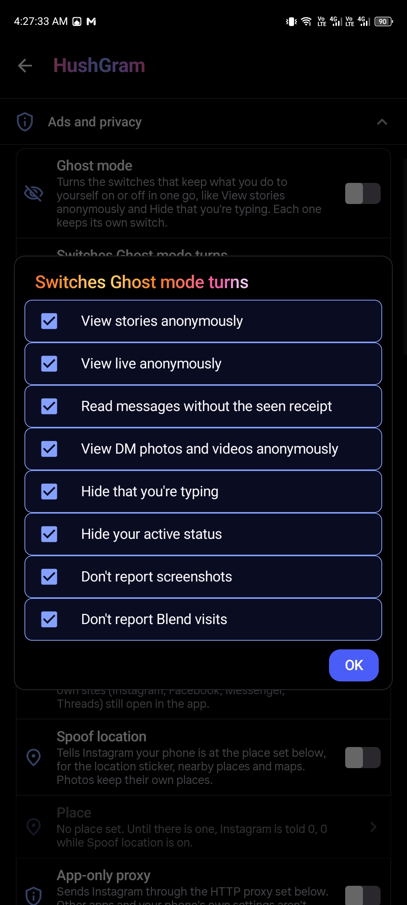
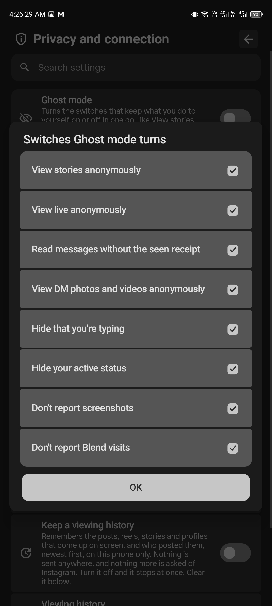
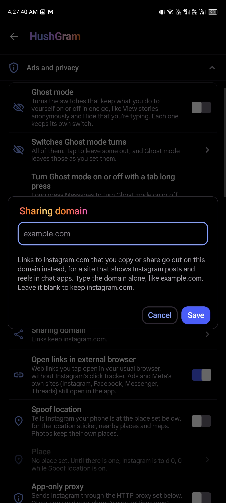
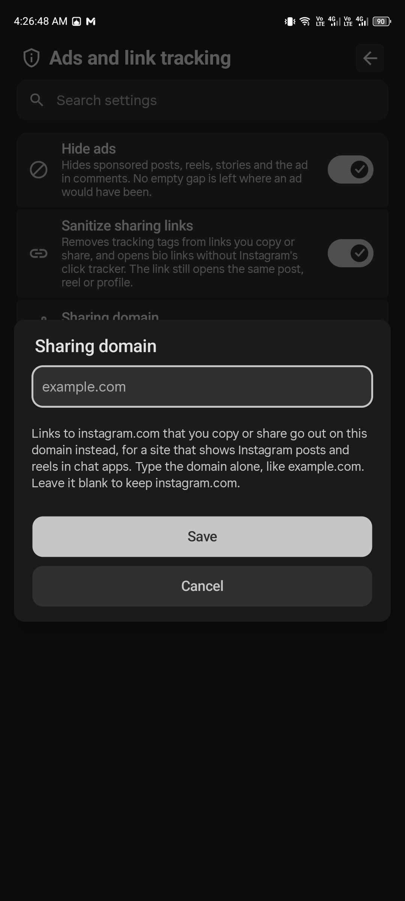

<p align="center">
  
</p>

# InstaPrime

I made InstaPrime as a personal settings UI and branding rework of HushGram, the Instagram patch project created by SysAdminDoc.

<p align="center">
  <a href="https://morphe.software/add-source?github=FarhanZafarr-9%2FInstaPrime"></a>
</p>

<p align="center"><a href="https://github.com/FarhanZafarr-9/InstaPrime/releases/tag/v0.0.19">Download InstaPrime v0.0.19</a></p>

**The Instagram patches, their underlying functionality, research, compatibility work, and ongoing upstream maintenance are the work of SysAdminDoc and the upstream contributors. I do not claim credit for that work.**

My contributions include the settings interface rework, chat popup styling and small chat-control additions, and the InstaPrime name and icon. I do not claim authorship of HushGram's patches or the work that keeps them working as Instagram changes. That credit belongs to SysAdminDoc and the contributors credited by the original project.

I started this out of personal interest in interface design. It is not a critique of HushGram's original UI: everyone has their own preferences and likes different interfaces. I wanted to try a layout that suits mine, and I am sharing it for anyone who likes the same approach.

InstaPrime v0.0.19 integrates HushGram 0.0.19 and subsequent main-branch changes, with 156 patches. The link adds my source to Morphe; patch and install Instagram with that source to use my redesigned interface.

## Updates and maintenance

I work on this out of personal interest and in my available time. Adapting the UI rework to new upstream patches takes time, testing, and maintenance, so updates here may sometimes be significantly delayed. I cannot promise to keep pace with every HushGram release.

If you need the latest available patches and compatibility updates promptly, please stick with the original HushGram project. Its project and Morphe source links are grouped under [Original project and support](#original-project-and-support) below. SysAdminDoc and the upstream contributors do the ongoing patch development and maintenance that this fork depends on.

## What I changed

I built on HushGram's existing settings and patch infrastructure, focusing on how its settings are presented and used:

- **Category navigation:** the settings home shows category rows that open their own pages. Larger categories have another level of grouping, with a back action and restored scroll positions.
- **Row layout:** borderless grouped rows, rounded corners, comfortable vertical and horizontal padding, space below search and at the bottom, and fully readable descriptions. Ripples stay inside the visible row. Enable all has a slightly taller row.
- **Optional info buttons:** description-less mode puts descriptions behind a separate rounded info button before a switch or chevron. Row taps still toggle switches or open choices. Disabled rows keep their explanation visible.
- **New-setting badges:** dots on the top-left of row icons and a subtle highlight identify unseen settings. Category and subcategory badges remain while any nested setting is unseen; visiting one subpage does not clear its siblings.
- **Settings colors:** wallpaper-derived Material tones on Android 12 and newer, with fallback colors on older Android versions. This describes the settings interface; it does not add wallpaper-colored backgrounds throughout Instagram.
- **Chat menus and dialogs:** connected rounded popup options, individual ripples, simple selection checkmarks, compact date actions, and wrapping labels. Chat previews and message-loading dialogs use the shared settings palette; the native date picker remains Android-managed.
- **Chat controls:** separate toggles hide Blend, Meta AI, or Location. Moving Gallery into the More menu keeps the microphone on the message bar because Instagram 454 does not provide a microphone action in that menu.
- **Settings background consistency:** the independent Black settings page option controls settings surfaces; the app-wide Pure black patch no longer overrides their tonal backgrounds. Main inbox and notifications background coverage still needs follow-up.
- **Switches:** rounded tracks and circular thumbs, an on-state checkmark, animations that survive row replacement, and clearer disabled states. Temporarily unavailable options retain their saved choices.
- **Dialogs:** rounded selection indicators, tonal backgrounds for selected and unselected choices, borderless text fields, vertically stacked full-width actions, and a redesigned restart notice.
- **Section controls:** an **Enable all** switch on pages containing direct toggle options, respecting each option's availability and validation. Category pages containing further subcategories do not show it.
- **Fork information:** a section at the top with my fork's details, the original project and creator, licenses, reporting, and upstream support links.
- **Branding:** the InstaPrime name and rounded camera icon in the settings entry, shortcut, launcher option, launch screen, and optional clone badge. The clone defaults to `InstaPrime` with package `com.instagram.android.prime`.

The core Instagram patches come from HushGram. The fork-specific presentation and small chat-control changes are listed above; credit for the inherited patch infrastructure and functionality remains with upstream. I retained the existing setting keys and backup format for compatibility.

## Before and after

Left: the original HushGram interface. Right: the InstaPrime rework. These captures compare presentation; different switch positions in the images are not changes to feature ownership or proof of changed defaults.

### Category navigation

| HushGram — original | InstaPrime — rework |
| --- | --- |
|  |  |

### Settings rows and switches

| HushGram — original | InstaPrime — rework |
| --- | --- |
|  |  |

### Selectable options

| HushGram — original | InstaPrime — rework |
| --- | --- |
|  |  |

### Text-entry dialogs

| HushGram — original | InstaPrime — rework |
| --- | --- |
|  |  |

The original screenshot files are kept in [docs/screenshots/settings](docs/screenshots/settings).

## Patches and compatibility

This checkout integrates upstream HushGram **0.0.19** and subsequent main-branch changes, with **156 patches** for Instagram. Features such as ad hiding, privacy controls, downloads, playback controls, and tab bar customization are inherited from upstream.

| Item | Inherited compatibility target |
| --- | --- |
| Android | Android 9 / API 28 or newer |
| Instagram package | `com.instagram.android` |
| Instagram version | `454.0.0.54.77` |
| arm64-v8a build | `386014758` |
| armeabi-v7a build | `386014757` |
| x86 build | `386014759` |
| x86_64 build | `386014760` |
| Morphe Manager | `2.5.0` or newer |

I inherited these compatibility targets from upstream; I have not independently repeated every upstream device test. See the [upstream guide](docs/upstream/README.md#supported-instagram-builds) and [upstream changelog](CHANGELOG.md) for the original feature and compatibility history. The changelog records HushGram's work; my changes are listed above.

<details>
<summary>Full patch catalog (156 patches)</summary>

| Patch | Description | Selection |
| --- | --- | --- |
| `Accent color` | Swaps Instagram's blue on Follow buttons, links and other highlights for purple, pink, red, orange, green, teal or your wallpaper's colors (Material You, on Android 12 and newer). Restart Instagram to see a change. Starts off. Turn it on in HushGram settings > Layout. | Included |
| `Allow screenshots` | Lets you take screenshots and record your screen where Instagram normally blocks it, such as disappearing photos and videos in chats. Starts off. Turn it on in HushGram settings > Messages. | Included |
| `Ambient light` | Puts a soft glow in a post's own colors around its photo or video in Home and Following, and in the bands around a reel that doesn't fill the screen. The glow follows a video as it plays, and you pick how far it spreads and how fast it changes. A second switch fills the bands above and below a story that doesn't fill the screen. Both start off. Turn them on in HushGram settings > Feed and Stories. | Included |
| `App-only proxy` | Sends Instagram through an HTTP proxy you set, without changing the proxy for other apps or the phone. You need to set a server too. Starts off. Turn it on in HushGram settings > Ads and privacy. | Included |
| `Ask before a call` | Asks you to confirm before a call starts from a chat, so a stray tap on the call button doesn't ring anyone, and can take the call buttons off the top of a chat. Both start off. Turn them on in HushGram settings > Messages. | Included |
| `Ask before a like` | Asks you to confirm before the Like button under a post likes or unlikes it, so a stray tap doesn't do it for you. Starts off. Turn it on in HushGram settings > Feed. | Included |
| `Ask before a refresh` | Asks you to confirm before pulling down refreshes Home, Reels or another list, so an accidental pull doesn't replace what you were reading. Starts off. Turn it on in HushGram settings > Feed. | Included |
| `Back leaves Home` | Makes Back on Home leave Instagram at once, instead of first scrolling the feed to the top and reloading it or saying "Tap again to exit". Starts off. Turn it on in HushGram settings > Feed. | Included |
| `Blur the bars around Reels` | Shows a blurred copy of a reel above and below it, or beside it, where Instagram would leave black bars. Starts off. Turn it on in HushGram settings > Reels. | Included |
| `Carousel arrows` | Puts a back and a next arrow on a post's carousel in Home and Following, so a tap moves to the next photo or video without a swipe, and can move its page dots onto a round pill over the photo. The pill can be solid, see-through or frosted glass. Both start off. Turn them on in HushGram settings > Feed. | Included |
| `Change the like animation` | Lets you pick the animation that plays when you double tap a post to like it. The choices are animations Instagram made for its Rings creators. Starts off. Turn it on in HushGram settings > Reels. | Included |
| `Change version code` | Stops Google Play from offering Meta's updates over your patched Instagram. Going back to the normal Instagram later means uninstalling first, which deletes its data. Later HushGram builds need this patch too. Works as soon as you patch it in, with no switch. | Opt-in |
| `Chat history tools` | Tap the clock button at the top of a chat, or long press its name, to jump to its first message or to a date, or to save the chat as a text file. The chat loads its older messages on its own, with a count and a Cancel button. Both start off. Turn them on in HushGram settings > Messages. | Included |
| `Chat plus menu` | Lets you take Saved, AI images, Draw, Meta AI and Location off the plus menu in a chat's message bar, and move Gallery into that menu. The microphone stays on the message bar to keep voice recording available. Starts with every switch off. Turn them on in HushGram settings > Messages. | Included |
| `Clean up Reels` | Hides extra buttons and prompts on reels, such as Follow, Edits, templates, Meta AI, Ray-Ban Meta glasses, friends' activity, the Add a comment bar, the reply bar on reels from chats, the Save button, the Create and Your algorithm buttons, the Friends tab and the Reels tab's top bar. Each one has its own switch, and Burn-in guard can dim a reel's buttons, and a story's, while you aren't touching the screen. Keep clear mode on carries Instagram's clear mode to the next reels, and can start every reel in it. Starts off. Turn it on in HushGram settings > Reels. | Included |
| `Clear the media cache` | Frees storage by deleting Instagram's saved copies of photos and videos once they pass 500 MB. Your sign-in, drafts and settings stay. A row clears them right away. Starts off. Turn it on in HushGram settings > Storage. | Included |
| `Control taps and volume on Reels` | Lets you choose what a single tap on a reel does: Instagram's default, pause, or mute. Can also keep a reel muted when you press volume up. Both start at Instagram's behavior. Choose them in HushGram settings > Playback. | Included |
| `Copy comment` | Adds Copy and Copy username to the menu you get on a comment, so you can copy its text or the commenter's username. Starts off. Turn it on in HushGram settings > Comments. | Included |
| `Data saver` | Saves mobile data by loading smaller photos and starting videos at the lowest quality. It uses Full resolution photos and Default playback quality, so it turns both on. It starts with mobile data only. Starts off. Turn it on in HushGram settings > Playback. | Included |
| `Default playback quality` | Plays videos, reels and video stories at the quality you choose, instead of the one Instagram picks as it plays. Nothing changes until you pick a quality. On by default. Turn it off in HushGram settings > Playback. | Included |
| `Don't report Blend visits` | Stops Instagram from telling a chat that you opened its Blend. Ghost mode, at the top of Ads and privacy, turns it on with the others. Starts off. Turn it on in HushGram settings > Messages. | Included |
| `Don't report screenshots` | Stops Instagram from telling people when you take a screenshot of their disappearing photo or video. Ghost mode, at the top of Ads and privacy, turns it on with the others. Starts off. Turn it on in HushGram settings > Messages. | Included |
| `Don't save recent searches` | Keeps the accounts and tags you open from search out of your Recent list. Searches already in Recent stay until you clear them. Starts off. Turn it on in HushGram settings > Explore. | Included |
| `Don't send reel watch history` | Stops Instagram from learning which reels you watched and how far you got. Reels you've already watched may come back. Starts off. Turn it on in HushGram settings > Reels. | Included |
| `Download any reel` | Adds Download to the menu of every reel and saves it without Instagram's watermark. You choose the quality, and best is the default. A separate Download cover switch also saves the reel's cover picture, the largest one the post carries, and Download audio saves just its sound. Download as video on a carousel with music saves every page, in order. A separate switch under Downloads puts a download icon under Save beside each reel, and others add a Lens icon for copying a reel's text, a speed icon and a Full screen icon. On by default. Turn it off in HushGram settings > Reels. | Included |
| `Download any story` | Adds Download to the menu of anyone's story. Videos save at the quality you choose and photos at their largest size, and Download as photo saves a still from a video story. A Download button at the top of a story is a separate switch, off to start, and so is a Copy text button that opens Google Lens on the story. Turn them on or off in HushGram settings > Stories. | Included |
| `Download any video` | Adds Download to video posts in your feed, saving the video without Instagram's watermark. Other switches add Download for photos, Download cover, a Details row with the post's time and poster, a download icon beside Save under each post, and Hold to download, which saves a post or reel you hold two fingers on. Download all waits its turn, with up to ten posts queued, so two posts' pages never mix in your gallery. Starts off. Turn it on in HushGram settings > Downloads. | Included |
| `Download voice messages` | Adds Save to the menu you get when you hold a voice message in a chat. It saves the recording as an audio file. Starts off. Turn it on in HushGram settings > Downloads. | Included |
| `Emoji style` | Shows every emoji in Google's style instead of your phone's own, or in a free emoji pack (Twemoji, OpenMoji, Blobmoji) or a color emoji font file you pick. The full change shows after you restart Instagram. Starts off. Turn it on in HushGram settings > Layout. | Included |
| `Explore without personalization` | Opens Explore on the grid that isn't personalized every time and keeps it from switching back after ten minutes. Instagram only promises that grid in the EU. A second switch hides the EU menu button for it. Both start off. Turn them on in HushGram settings > Explore. | Included |
| `Find the reel you came from` | Open a creator's profile from a reel, then their Reels tab, and it scrolls to that reel and outlines it for a moment. A photo reel is found in their posts. Stop looking ends the search, and Wait for a tap to find it holds it until you tap Find the reel. Starts off. Turn it on in HushGram settings > Reels. | Included |
| `Font` | Lets you pick the font Instagram's text uses: Instagram's own, your phone's, or a .ttf or .otf file. Restart Instagram to see a change. Starts on Instagram's font. Pick one in HushGram settings > Layout. | Included |
| `Full resolution photos` | Loads photos in the largest size Instagram sends instead of one picked for your screen. A second switch asks for a larger size on screens under 1440 pixels wide, and a third gets reel covers and grid pictures at full size. Uses more data. Starts off. Turn it on in HushGram settings > Feed. | Included |
| `Full screen Reels and Home` | Hides the status bar and the navigation bar while Reels shows, and optionally while Home or your messages do. Swipe in from the edge to bring them back for a moment. Back and the keyboard work as usual. It can also show stories over the whole screen on tall phones. Starts off. Turn it on in HushGram settings > Reels (Full screen Reels), Feed (Full screen Home), Messages (Full screen Messages) and Stories (Stories fill the screen). | Included |
| `Glass in chats` | Gives a chat's top bar frosted glass that blurs the messages under it (Android 12 and newer) and puts the back, call and video buttons on round glass circles. Starts off. Turn it on in HushGram settings > Messages. | Included |
| `Glass tab bar` | Draws the tab bar as a floating, rounded pill of frosted glass that blurs what's behind it (Android 12 and newer), with a highlight on the tab you're on. Content can optionally run down behind it. Starts off. Turn it on in HushGram settings > Tab bar, then restart Instagram. | Included |
| `Group Instagram's notifications` | Puts Instagram's notifications in one group, or in a group for each type, so they don't fill your notification shade. Tapping one still opens it. You can also mute the types you pick, like promo pushes. Starts off. Turn it on in HushGram settings > Notifications. | Included |
| `Hide AI-labeled reels` | Leaves out reels that carry Instagram's own AI label. A reel without that label stays. Starts off. Turn it on in HushGram settings > Reels. | Included |
| `Hide Follow on feed posts` | Takes the Follow and Subscribe buttons off the top of posts in your feed. The name, time and menu stay. Starts off. Turn it on in HushGram settings > Feed. | Included |
| `Hide Follow on stories` | Takes the Follow button off the top of stories from accounts you don't follow. The name, time and menu stay. Starts off. Turn it on in HushGram settings > Stories. | Included |
| `Hide Instants` | Takes the stack of Instants out of your messages. Instants is Instagram's no-edit camera for sharing quick photos with friends. Starts off. Turn it on in HushGram settings > Messages. | Included |
| `Hide Meta AI` | Removes Meta AI from Instagram's search bars, messages, home top bar, reels menus, share sheet and feed. Each part has its own switch. The search one and the Meta AI posts one start on, the rest start off. Change them in HushGram settings > Meta AI. | Included |
| `Hide Notes on profile pictures` | Takes the Notes bubble off profile pictures, yours included. Notes in Messages stay. Starts off. Turn it on in HushGram settings > Profiles. | Included |
| `Hide Reels in the feed` | Removes the rows of suggested reels from your home feed. A reel posted by someone you follow stays. Starts off. Turn it on in HushGram settings > Reels. | Included |
| `Hide activity bubbles` | Takes the little round pictures off posts and reels that show a friend liked, commented on or reshared them. Starts off. Turn it on in HushGram settings > Feed. | Included |
| `Hide ads` | Hides sponsored posts, reels, stories and the ad in comments, and leaves no gap where an ad would have been. On by default. Turn it off in HushGram settings > Ads and privacy. | Included |
| `Hide captions` | Takes the caption off posts in your feed and off reels. The post stays, and the comments sheet still shows it. Starts off. Turn it on in HushGram settings > Feed. | Included |
| `Hide comments` | Takes the Comment button and the comment count off posts in your feed. Starts off. Turn it on in HushGram settings > Comments. | Included |
| `Hide group buttons on the share sheet` | Takes the New group button and the button that sends to several people as a group off the share sheet, and lets you pick which of the round buttons under the people it shows. You can still start a group from your messages. Both start off. Find them in HushGram settings > Sharing. | Included |
| `Hide highlights` | Takes the row of story highlights off profiles, yours and other people's. Bios, counts and posts stay. Starts off. Turn it on in HushGram settings > Profiles. | Included |
| `Hide paid partnership Reels` | Leaves out reels with a Paid partnership label, and reels Instagram marks as boosted. Ads have their own switch. Starts off. Turn it on in HushGram settings > Reels. | Included |
| `Hide profile tabs` | Lets you take the Reels, Reposts and Tagged tabs off profiles, yours and other people's, and keep the grid. Starts with every tab showing. Pick which to hide in HushGram settings > Profiles. | Included |
| `Hide reels by caption words` | Leaves out reels whose caption holds a word or phrase from your list, or is in a language you don't keep, and Home's posts too with Also on Home. Starts off. Turn it on and type the words or languages in HushGram settings > Reels. | Included |
| `Hide reels with few views` | Leaves out reels in the Reels tab with fewer views or likes than numbers you pick. Accounts you follow stay. Starts off. Turn it on in HushGram settings > Reels. | Included |
| `Hide rows in Instagram's settings` | Lets you take the rows you don't use off Instagram's own Settings and activity screen. Open that screen once, then untick rows in HushGram settings > Layout > Rows in Instagram's settings. Every row shows to start. | Included |
| `Hide suggested accounts in DMs` | Takes the Accounts to follow section off the bottom of your messages. Your chats and follow requests stay. Starts off. Turn it on in HushGram settings > Messages. | Included |
| `Hide suggested accounts in Reels` | Leaves out the cards of accounts to follow that Instagram puts between reels. Every reel still plays. Starts off. Turn it on in HushGram settings > Reels. | Included |
| `Hide suggested people on profiles` | Takes Suggested for you and the Discover people button off profiles. Bios, counts and posts stay. More switches take Suggested for you off the follow lists, their Suggested tab and the Follow requests screen, the Complete your profile cards off your own profile, and People you don't follow back, suggested threads and people, and the Featured section off your notifications. Starts off. Turn it on in HushGram settings > Profiles. | Included |
| `Hide suggested posts` | Removes posts from accounts you don't follow, suggested accounts, surveys and shopping rows from Home. It also takes shop tiles out of Explore and the shopping bag off posts with tagged products. Posts from accounts you follow stay. Extra switches can also hide the 'Are you interested in this post?' question on Home and Reels, the caught up card, all videos, photos, carousels, posts you've liked or posts from accounts you pick. A post's menu has Hide posts from this account to add one to that list, and those posts leave Home on the next refresh. On by default. Turn it off in HushGram settings > Feed. | Included |
| `Hide suggested stories` | Removes stories from accounts you don't follow from the row at the top of Home. More switches hide rewinds and memories, keep only verified or unverified accounts, or hide the whole row. Starts on. Turn it off in HushGram settings > Stories. | Included |
| `Hide that you're typing` | Stops the people you're chatting with from seeing when you're typing. You still see when they type. Ghost mode, at the top of Ads and privacy, turns it on with the others. Starts off. Turn it on in HushGram settings > Messages. | Included |
| `Hide the Explore grid` | Empties the grid of posts and reels on the Search tab. Search, recent searches and results stay. A second switch hides the suggested accounts that show when you tap the search bar. Starts off. Turn it on in HushGram settings > Explore. | Included |
| `Hide the Reels tab` | Takes the Reels tab off the tab bar. Reels in your feed and reels people send you still open. A second switch, Show the Reels tab, puts it back after Home when Instagram built your bar without one, and Hide wins if both are on. Restart Instagram to see the change. Starts off. Turn it on in HushGram settings > Reels. Under Tab bar, switches do the same for Home, Search, Create, Messages and Profile, two put Messages or Activity on the bar when Instagram left them off, switches take the Create and notifications buttons off Home's header, others add a Search, Messages, Ghost mode or menu button to it or put Instagram's logo in its middle, two center the name at the top of profiles and the title on other screens, a list puts the tabs in your order, and another picks the tab Instagram opens on. | Included |
| `Hide the Repost button` | Takes the Repost button and its count off posts and reels, so nothing gets reposted by mistake. Share still works. Starts off. Turn it on in HushGram settings > Sharing. | Included |
| `Hide the Share button` | Takes the Share button and its count off posts in your feed and off reels. Starts off. Turn it on in HushGram settings > Sharing. | Included |
| `Hide the Threads button` | Takes the Threads button off the top of profiles, with switches for the Create button and Share profile on your own, and Subscribe and the arrow after the buttons on creators' profiles. The menu and the other buttons stay. Each starts off. Turn them on in HushGram settings > Profiles. | Included |
| `Hide the audio icon on posts` | Takes the speaker icon off videos in your feed. Tapping the video still turns the sound on or off. Starts off. Turn it on in HushGram settings > Feed. | Included |
| `Hide the comment emoji row` | Takes the row of quick emoji off above the comment box. The box itself stays. Starts off. Turn it on in HushGram settings > Comments. | Included |
| `Hide the home feed` | Empties your home feed on purpose, so Home shows only the stories row. Profiles, Explore and Reels still show posts. Starts off. Turn it on in HushGram settings > Feed. | Included |
| `Hide the notes row` | Takes the row of notes, and the Map bubble in it, off the top of your messages. Your chats stay. A second switch takes only the Map bubble. Both start off. Turn them on in HushGram settings > Messages. | Included |
| `Hide the reply box on stories` | Takes the Send message box off the bottom of other people's stories. The like and share buttons next to it stay where they are. Starts off. Turn it on in HushGram settings > Stories. | Included |
| `Hide the search bar in Messages` | Takes the search bar and its Filter button off the top of your messages, the Meta AI bar too. Your chats and notes stay. Starts off. Turn it on in HushGram settings > Messages. | Included |
| `Hide your active status` | Stops people from seeing Active now for you while you use Instagram. You still see when they're active. Ghost mode, at the top of Ads and privacy, turns it on with the others. Starts off. Turn it on in HushGram settings > Messages. | Included |
| `Home header text` | Puts words of your own, or a picture, at the top of Home in place of Instagram's logo. Nothing changes until you set one in HushGram settings > Layout. | Included |
| `InstaPrime launch screen` | Shows InstaPrime's logo instead of Instagram's on the screen you see while Instagram starts, on Android 13 and newer. Starts off. Turn it on in InstaPrime settings > Layout. | Included |
| `InstaPrime settings` | Adds a InstaPrime settings page to Instagram. Open it by long-pressing the Instagram logo at the top of your feed or Instagram's icon, or from the top of Settings and activity. Turn features on or off there, pause InstaPrime and save diagnostics. Works as soon as you patch it in, with no switch. | Included |
| `Install next to Instagram` | Installs this build as a second Instagram beside your normal one, with its own data and sign-in. Pick its package name and app name in the patch's options, and whether its icon gets an InstaPrime badge. Works as soon as you patch it in, with no switch. | Opt-in |
| `Jump a profile's posts to a date` | Puts a calendar on a profile's top bar. Pick a day and the posts grid goes back to that day, with older posts as you scroll. Pull down for the newest again. Starts off. Turn it on in HushGram settings > Profiles. | Included |
| `Keep Home's top bar` | Keeps the Instagram logo and the buttons beside it at the top of Home while you scroll. A second switch shows your feed blurred under them. Both start off. Turn them on in HushGram settings > Feed. | Included |
| `Keep Reels auto scroll on` | Keeps Instagram's auto scroll in Reels turned on after you leave Reels or restart Instagram, until you turn it off yourself. It can also move on to the next reel when one ends on accounts where Instagram doesn't offer auto scroll. Starts off. Turn it on in HushGram settings > Reels. | Included |
| `Keep a seek bar on Reels` | Keeps a seek bar under every reel, short ones too, with the time played and the reel's length above it, like 0:10 / 0:55. Starts off. Turn it on in HushGram settings > Reels. | Included |
| `Keep in chat` | Keeps view once and replayable photos and videos in your chats after you open them, so they don't disappear. A photo or video you send stays Instagram's own sent bubble. Starts off. Turn it on in HushGram settings > Messages. | Included |
| `Keep playing in the background` | A video or reel playing with sound keeps going when you leave Instagram or turn the screen off, with a notification to pause or stop it. Starts off. Turn it on in HushGram settings > Playback. | Included |
| `Keep stories playing while zooming` | Keeps a story playing while you pinch to zoom it, instead of pausing it. A story you hold still first stays paused. Starts off. Turn it on in HushGram settings > Stories. | Included |
| `Keep the Reels top bar` | Keeps the Reels title, the Friends tab and the buttons beside them at the top while you swipe through reels. Starts off. Turn it on in HushGram settings > Reels. | Included |
| `Keep the reel speed` | Keeps the 2x speed on for the next reels after you lock a reel at 2x (hold its edge, then slide down), until you slide the lock off. On by default. Turn it off in HushGram settings > Reels. | Included |
| `Keep your place in Home` | Coming back to Instagram leaves Home on the post you were on, however long you were away, instead of reloading it and jumping to the top. Starts off. Turn it on in HushGram settings > Feed. | Included |
| `Lock your messages` | Covers your inbox and chats, all of Instagram, or just the single chats you pick under Locked chats, until your fingerprint, face or screen lock says it's you. Message notifications only say that a message came. Chats you pick under Hidden chats leave your inbox and their notifications don't post. Starts off. Turn it on in HushGram settings > Messages. | Included |
| `Long press to zoom` | Press and hold a photo in a feed to see it twice as big around your finger, and let go to close it. Pinch to zoom still works. Keep the zoom open leaves it up after you let go, to drag and pinch from 1x to 4x until a tap or Back closes it. Long press a post for full screen opens any photo or video on black instead, a video with a slider. While its switch is on, each takes the place of Instagram's own long press. Starts off. Turn it on in HushGram settings > Feed. | Included |
| `Loop a story` | Plays a story again from the start when it ends, instead of moving on to the next one. Tap or swipe to move on. Starts off. Turn it on in HushGram settings > Stories. | Included |
| `Mark one-time photos and videos` | Puts a border and Instagram's own view once icon on a one-time photo or video in a chat, so you can tell it before you open it. Only how the chat looks changes. Nothing is saved, replayed, marked seen or sent. Starts off. Turn it on in HushGram settings > Messages. | Included |
| `Message box buttons` | Lets you take the gallery, sticker and voice message buttons off the message box of a chat, and keep the text box and Send. Starts with every button showing. Pick which to hide in HushGram settings > Messages. | Included |
| `Open comments without the keyboard` | Comments open with the keyboard down. A tap in the comment box, or on Reply, still brings it up. Starts off. Turn it on in HushGram settings > Comments. | Included |
| `Open links in external browser` | Opens web links you tap in your usual browser instead of Instagram's built-in one, without Instagram's click tracker. Ads and Meta's own sites (Instagram, Facebook, Messenger, Threads) still open in the app. On by default. Turn it off in HushGram settings > Ads and privacy. | Included |
| `Phone layout on big screens` | On a foldable or tablet, Instagram keeps its phone layout across the whole screen, with the tab bar at the bottom instead of down the side. Restart Instagram to see the change. Starts off. Turn it on in HushGram settings > Layout. | Included |
| `Pick the app icon` | Lets you pick the icon Instagram shows on your home screen: Instagram's own, InstaPrime's, Instagram's glyph on black, on plum, or in black on white, a hand-drawn Instagram glyph on white, Instagram's gradient glyph on dark, the old retro camera icon, or Instagram's glyph in pink on pale pink. The new icon shows once you leave Instagram, and you may need to add it to your home screen again from the app drawer. Starts on Instagram's own. Pick one in InstaPrime settings > Layout. | Included |
| `Pinch to zoom on Reels` | Lets you zoom into a playing reel with two fingers, the way a photo zooms. Lift your fingers and it goes back. Restart Instagram to see the change. Starts off. Turn it on in HushGram settings > Reels. | Included |
| `Preview chats` | Long press a chat in your messages and tap Preview to read its newest messages without opening it, so nobody sees Seen. You can reply from there too. Starts off. Turn it on in HushGram settings > Messages. | Included |
| `Profile posts as a list` | Opening someone's profile takes you on to their posts as a scrolling list of full posts. Back shows the grid. Your own profile keeps its grid. Starts off. Turn it on in HushGram settings > Profiles. | Included |
| `Pure black dark mode` | Makes Instagram's dark mode pure black instead of dark gray, on the menus that slide up from the bottom too. It looks deeper and can save battery on an OLED screen. Buttons keep their grays so they stay easy to see. Works as soon as you patch it in, with no switch. | Opt-in |
| `Read messages without the seen receipt` | Opening a chat no longer tells people you've seen their messages. You still see when they've seen yours. Mark as read, or the check mark at the top of a chat, still tells them. With `Choose Seen in each chat` on, an eye at the top of each chat holds or sends Seen in that chat alone, whichever way the main switch is. Ghost mode turns it on too. Starts off. Turn it on in HushGram settings > Messages. | Included |
| `Remove build expired popup` | Stops Instagram from locking you out with a screen that says this version is too old. A patched build can't update itself, so it would stop working after a few weeks. On by default. Turn it off in HushGram settings > Version warnings. | Included |
| `Remove the advertising ID` | Stops Instagram from reading your phone's advertising ID, which ad companies use to follow you between apps. Instagram gets a string of zeros instead. Works as soon as you patch it in, with no switch. | Included |
| `Remove the empty space at the bottom` | Takes away the empty gap Instagram leaves under its tab bar for a navigation bar that isn't there. Restart Instagram to see the change. Starts off. Turn it on in HushGram settings > Layout. | Included |
| `Restore trust on re-signed builds` | Lets Instagram's own checks of who signed the app pass on a patched build, so the parts that need them keep working. Threads, Facebook and Messenger patched with the same key work too. Works as soon as you patch it in, with no switch. | Included |
| `Resume long videos` | A video or reel longer than two minutes picks up where you left off the next time you play it on the same account. Live videos and ads start as usual. Starts off. Turn it on in HushGram settings > Playback. | Included |
| `Rounded post corners` | Rounds the corners of a post's photo, video and carousel pages in Home and Following, and of reels and stories if you like, at a small or large size. Profiles and Explore stay as Instagram draws them. Starts off. Turn it on in HushGram settings > Feed. | Included |
| `Sanitize sharing links` | Removes tracking tags from the links you copy or share, and opens bio links without Instagram's click tracker. The link still opens the same post, reel, story or profile. On by default. Turn it off in HushGram settings > Ads and privacy. | Included |
| `Save comment photo` | Adds Save to the menu on a comment that has its own photo or GIF, saving the largest size Instagram sent. A GIF is saved as a .gif in Pictures/Instagram, taken from Instagram's own copy, not Giphy. If Instagram lists only an animated WebP or an MP4 for it, you get that file instead, and an MP4 goes in Movies/Instagram like a video. It can also add a GIF reply to a comment with a GIF, sending that same GIF back as your reply, or show a comment GIF's or sticker's name in that menu. Starts off. Turn it on in HushGram settings > Comments. | Included |
| `Save profile picture` | Adds Save profile picture, View profile picture, Copy username and Copy bio to the menu on someone's profile. View opens the picture full screen and lets you zoom. Starts off. Turn it on in HushGram settings > Downloads. | Included |
| `Saved on your profile` | Adds a bookmark to the tabs on your own profile, beside posts, reels and tagged, that opens Saved. Starts off. Turn it on in HushGram settings > Profiles, then restart Instagram. | Included |
| `See who a story mentions` | Adds a small label in a story's header showing how many accounts it mentions. Tap it for a list and tap an account to open their profile. Starts off. Turn it on in HushGram settings > Stories. | Included |
| `Seek bar on feed videos` | Shows a bar along the bottom of the video playing in your feed that you can drag to jump to any point in it. Starts off. Turn it on in HushGram settings > Feed. Another switch there adds a small button on the video that shows or hides the bar, and a choice under it makes the bar see-through or puts it on frosted glass. | Included |
| `Seek bar on stories` | Shows a bar near the bottom of a video story that you can drag to jump to any point in the video. Photos don't get one. A choice under it makes the bar see-through or puts it on frosted glass. Starts off. Turn it on in HushGram settings > Stories. | Included |
| `Show a post's exact time` | Shows the date and time a post went up, like Oct 2, 3:45 PM, instead of how long ago. It does the same for comments. Starts off. Turn it on in HushGram settings > Feed. | Included |
| `Show a reel's exact time` | Adds the date and time a reel was posted under the author's name, like Oct 2, 3:45 PM, with the seconds or how long ago (1d 2h 5m ago) if you want them. Starts off. Turn it on in HushGram settings > Reels. | Included |
| `Show a story's exact time` | Shows the date and time a story was posted, like Oct 2, 3:45 PM, instead of how long ago. A choice under the switch can show the time left instead. Starts off. Turn it on in HushGram settings > Stories. | Included |
| `Show all recent searches` | Lists every recent search under the search bar instead of the first few. See all and the x on each row work as before. Starts off. Turn it on in HushGram settings > Explore. | Included |
| `Show hidden like counts` | Shows how many likes a post or reel has when its owner hid the count, as long as Instagram's server still sends the number. If it doesn't, nothing changes. Starts off. Turn it on in HushGram settings > Feed. | Included |
| `Show if a profile follows you` | Adds Follows you or Doesn't follow you beside the name on someone's profile. Other switches add a chip and mark accounts on your Following list that don't follow you back, and Recent unfollowers shows who left your Followers list, with a Follower history of who left, came back or is new. The chip is blue for Follows you, green for Following each other and red for Doesn't follow you, and it can go small under the profile picture. On by default. Turn it off in HushGram settings > Profiles. | Included |
| `Show when someone was last active` | Shows the exact time someone was last on, like Active at 3:42 PM, in your messages and in a chat, instead of Active 3h ago. Active now stays. Starts off. Turn it on in HushGram settings > Messages. | Included |
| `Skip the ad data reminder` | Stops Instagram's reminder to review whether it can process your data for ads from opening by itself. Your ad choice doesn't change and nothing is answered for you. Starts off. Turn it on in HushGram settings > Ads and privacy. | Included |
| `Skip the collections tray` | Saving a post or reel shows Instagram's Saved message instead of the tray that asks you to start a collection. Starts off. Turn it on in HushGram settings > Feed. | Included |
| `Skip the contacts and location popups` | Stops the screens asking you to sync your contacts and turn on location services from opening each time Instagram starts. Nothing else is skipped. Starts off. Turn it on in HushGram settings > Ads and privacy. | Included |
| `Smooth story opening` | Opens a story from the stories row with a slower, gentler zoom instead of Instagram's quick spring. Starts off. Turn it on in HushGram settings > Stories. | Included |
| `Speed button on stories` | Puts a speed button at the top of a video story. Tap it to play the story at 1.5x or 2x, and later video stories keep that speed. Photos and ads play as usual. Starts off. Turn it on in HushGram settings > Stories. | Included |
| `Spoof location` | Tells Instagram your phone is at a place you pick, for the location sticker, nearby places and maps. Photos keep their own places. You need to pick a place too. Starts off. Turn it on in HushGram settings > Ads and privacy. | Included |
| `Start Home on Following` | Opens Home on posts from accounts you follow instead of For you. A second switch removes For you from Home, and a third keeps Instagram's logo at the top of Home in place of the feed's name. A fourth, Fall back to Following, opens Home on Following for an account whose For you brings only suggested posts, unless you picked a feed. A fifth, Mix in Following, shows a page of posts from accounts you follow after each page of For you. Restart Instagram to see the change. Starts off. Turn it on in HushGram settings > Feed. | Included |
| `Start feed videos with sound` | Starts the first video on Home with its sound on, the same as tapping the video's speaker. Your phone's ringer and volume still count. Starts off. Turn it on in HushGram settings > Feed. | Included |
| `Start on x86 devices` | Stops Instagram from crashing or freezing on x86 devices that run its code through a translator, such as some Chromebooks and emulators. Phones and tablets with arm chips run it as before. Works as soon as you patch it in, with no switch. | Included |
| `Start reels with sound` | A reel you open from the Reels tab or a post on Home plays with sound, and Home is muted again when you go back. Your phone's ringer and volume still count. A separate switch, Start reels muted, starts every reel silent instead. Both start off. Turn them on in HushGram settings > Playback. | Included |
| `Start stories with sound` | Opens stories with their sound on, the same as tapping Instagram's speaker. Your phone's ringer and volume still count. Starts off. Turn it on in HushGram settings > Stories. | Included |
| `Stop Reels scrolling` | Stops a swipe in Reels from moving to the next reel, so you stay on the one you opened, with switches that leave reels from a profile, Search and Explore or a song page free to scroll. Another switch stops swiping after as many reels as you pick, for as long as you pick, and Take a scroll break covers Home, Reels and Explore for 5 minutes after the time you pick. Starts off. Turn it on in HushGram settings > Reels. | Included |
| `Stop Story auto-advance` | Keeps each story on screen until you tap or swipe. Starts off. Turn it on in HushGram settings > Stories. | Included |
| `Stop background wake-ups` | Stops two alarms that wake your phone while Instagram is in the background. One goes off every minute or two only to note that Instagram is still running, and the other wakes it five minutes later to upload usage events. Messages and notifications still arrive. Starts off. Turn it on in HushGram settings > Battery. | Included |
| `Stop swipe to create` | Stops a sideways swipe on Home from opening the camera. The + button still opens it. Starts off. Turn it on in HushGram settings > Feed. | Included |
| `Stop swipe up to reply` | Stops a swipe up on someone's story from opening the reply box and its reactions. Tapping Send message still replies. Starts off. Turn it on in HushGram settings > Stories. | Included |
| `Stop swiping between tabs` | Stops a sideways swipe from moving between Home, Reels and the other main tabs. Tapping the tab bar still works. Starts off. Turn it on in HushGram settings > Feed. | Included |
| `Stop videos looping` | Feed videos and reels stop at their last frame instead of playing again. Reels still loop while auto scroll is on, so it can move on. Starts off. Turn it on in HushGram settings > Playback. | Included |
| `Stories priority` | Puts the accounts on your list first in the stories row at the top of Home while they have a story you haven't watched. Starts off. Turn it on and type the accounts in HushGram settings > Stories. | Included |
| `Story ring size` | Draws the rings in the stories row at the top of Home smaller, so more fit on screen, or larger, and the ring of a story you haven't watched in a color you pick. Nothing changes until you pick a size or a color. On by default. Turn it off in HushGram settings > Stories. | Included |
| `Story text fonts` | Adds fonts you pick from your phone (.ttf or .otf files) to the story text editor alongside Instagram's own fonts, and can draw the emoji in story text from an emoji font file you pick. Starts off. Set both up in HushGram settings > Stories. | Included |
| `Swipe left to open the profile` | Makes a left swipe on a reel open the profile of the person who posted it, like Instagram used to. Tap Friends at the top to reach your friends' reels. Starts off. Turn it on in HushGram settings > Reels. | Included |
| `Swipe through a chat's photos and posts` | Open a photo or video from a chat and swipe up through the chat's other photos, videos and shared posts, in chat order. Starts off. Turn it on in HushGram settings > Messages. | Included |
| `Swipe through a chat's reels` | Swiping up on a reel you opened from a chat goes through the other reels shared in that chat before any suggested reels, can stop after them and can leave out the ones you sent. All start off. Turn them on in HushGram settings > Messages. | Included |
| `Tab bar layout` | Lets you keep the newer tab bar, where you swipe between every tab, or the classic one, instead of the one Instagram picks for your account. Starts on Instagram's choice. Pick one in HushGram settings > Tab bar. | Included |
| `Tap a feed video to pause it` | A tap on the video playing in a feed pauses it in place instead of opening it in Reels, and another tap plays it again. Ads keep Instagram's own tap. Starts off. Turn it on in HushGram settings > Feed. | Included |
| `Tap to play` | Makes videos, reels and stories wait for your tap instead of starting by themselves, like Instagram does when it saves mobile data. A choice under the switch can leave Reels out or hold only Reels. Starts off. Turn it on in HushGram settings > Playback. | Included |
| `Thicker story progress bar` | Draws the progress bar along the top of a story twice or three times as thick. Its segments and timing stay as they were. Starts off. Turn it on in HushGram settings > Stories. | Included |
| `Turn off HDR brightness boosts` | Stops HDR photos and reels from making the screen brighter than everything else. Starts off. Turn it on in HushGram settings > Playback. | Included |
| `Turn off double tap to like` | Stops a double tap on a post or reel from liking it, and the heart doesn't show. The Like button still works. Separate switches cover posts, reels, comments and chat messages. Starts off. Turn it on in HushGram settings > Reels. | Included |
| `Upload stories at full quality` | Sends the video stories you post at 1080p and a higher bitrate, as Instagram does with its own Upload at highest quality setting on. Two choices under it can cover posts and reels too and ask for a bitrate up to 50 Mbps. Instagram still shrinks story videos to 720p on its servers, so viewers see a small difference. Starts off. Turn it on in HushGram settings > Stories. | Included |
| `Use the highest refresh rate` | Asks Android to run Instagram at your screen's fastest refresh rate, at the same resolution, so scrolling looks smoother on a 90 or 120 Hz phone. Some phones keep their own limit for apps. Starts off. Turn it on in HushGram settings > Layout. | Included |
| `View DM photos and videos anonymously` | Holds back the Opened notice for view once photos and videos in messages, so the sender doesn't see you opened them. Ghost mode turns it on too. Starts off. Turn it on in HushGram settings > Ads and privacy. | Opt-in |
| `View live anonymously` | Keeps you off the viewer list of the lives you watch, so the host isn't told you're there. Your own lives still count their viewers. An optional eye button at the top of a live puts you on that one's list. Ghost mode turns it on too. Starts off. Turn it on in HushGram settings > Stories. | Included |
| `View stories anonymously` | Keeps you off the viewer list of the stories you watch. Replying or reacting still shows you. An optional Mark as seen button lets you choose. Ghost mode turns it on too. Starts off. Turn it on in HushGram settings > Stories. | Included |

</details>

## Install the UI rework

1. Install [Morphe Manager](https://github.com/MorpheApp/morphe-manager) 2.5.0 or newer.
2. [Add my source to Morphe](https://morphe.software/add-source?github=FarhanZafarr-9%2FInstaPrime), or open **Sources → + → Remote** in Manager and enter `github.com/FarhanZafarr-9/InstaPrime`.
3. Refresh the source and use InstaPrime as the only enabled Instagram patch source for this patch run.
4. Select a stock Instagram APK matching the version and build above, choose the patches you want, then patch and install.
5. Open **InstaPrime** at the top of Instagram's **Settings and activity**, or long-press the Instagram logo on Home. Choose a category to open its settings.

For a local source, download the `.mpp` from [my release](https://github.com/FarhanZafarr-9/InstaPrime/releases/tag/v0.0.19) and add it through **Sources → + → Local**. A `.mpp` is a patch bundle, not an Instagram APK.

For a separate installation, select **Install next to Instagram**. I set the clone defaults to the label **InstaPrime** and package **`com.instagram.android.prime`**. Keep the same package name and signing key for subsequent updates.

Keep a backup of your Morphe signing key. Android requires the same key to update an existing patched installation while preserving its data. A differently signed installation may require uninstalling the existing app, which deletes its local data. See the [upstream signing-key guide](docs/upstream/README.md#keep-your-signing-key).

The original HushGram releases and patch source remain available from [SysAdminDoc/HushGram](https://github.com/SysAdminDoc/HushGram). SysAdminDoc and the upstream contributors maintain those releases; my UI build is separate.

## Build from source

Use the upstream build prerequisites: JDK 17 or newer, the Android SDK, and a GitHub token with `read:packages` access for the Morphe patcher dependency. Supply credentials through environment variables; never put a token in source files or commit it.

```bash
export GITHUB_ACTOR="your-github-username"
export GITHUB_TOKEN="your-package-read-token"
./gradlew :patches:generatePatchesList --max-workers=1
./gradlew :patches:buildAndroid --max-workers=1
```

On Windows, set the variables using `$env:GITHUB_ACTOR` and `$env:GITHUB_TOKEN`, and run `gradlew.bat` instead of `./gradlew`.

Run the two build commands in the order shown. The bundle is written to `patches/build/release/patches-<version>.mpp`, alongside build verification artifacts. The documentation screenshots live outside that generated build directory so a clean build will not remove them.

I used these focused settings checks for the rework:

```bash
./gradlew :extensions:instagram:testDebugUnitTest --tests 'app.hushgram.extension.instagram.settings.SettingsCardsTest' --max-workers=1
```

For v0.0.18, **101 focused UI checks passed**, covering navigation, actual row and switch touch events, selectable settings, info buttons, new-setting badges and highlights, accessibility, and normal and double font sizes. The generated bundle passed its integrity checks for **139 patches and all three non-empty DEX payloads**. The inherited full fixture release gate and whole-app device walkthrough were not run for this fork release. These checks do not replace testing a patched APK on your own device.

For the full upstream build workflow, fixture-based patch tests, and release checks, see the [upstream build guide](docs/upstream/README.md#building-from-source) and [CONTRIBUTING.md](CONTRIBUTING.md).

## Reporting problems

Report issues with my settings navigation, visuals, switches, dialogs, or branding in [my issue tracker](https://github.com/FarhanZafarr-9/InstaPrime/issues).

For an underlying patch problem, first check whether it also happens with the original HushGram build. If it does, follow the [upstream reporting guide](docs/upstream/README.md#getting-help), identify the build you used, and include the requested diagnostics. Please do not ask the original creator to support changes specific to this fork.

## Credits and support

**SysAdminDoc deserves the credit for creating HushGram and for the continuing research, development, testing, compatibility updates, and maintenance behind its patches.** The upstream contributors and the projects HushGram builds on retain their own authorship and attribution.

My contribution is the settings UI rework, navigation and control presentation, documentation, and InstaPrime branding described here. I do not take credit for creating the patch collection or for upstream maintenance. I chose a separate name to identify my fork; it does not imply endorsement by SysAdminDoc.

### Original project and support

- [HushGram source and releases](https://github.com/SysAdminDoc/HushGram)
- [SysAdminDoc, the original creator](https://github.com/SysAdminDoc)
- [Support SysAdminDoc on Ko-fi](https://ko-fi.com/X8K126YVER)
- [Add original HushGram to Morphe](https://morphe.software/add-source?github=SysAdminDoc%2FHushGram)

### Documentation and attribution

- [Original HushGram guide](docs/upstream/README.md)
- [Upstream project credits](docs/upstream/README.md#where-the-patches-come-from)
- [Source and license ledger](sources/instagram-sources.json)
- [License](LICENSE) and [notices](NOTICE)

HushGram also carries work and foundations from Hushfacebook, Hushfeed, HushPinterest, Andrew Liang's patches, Morphe, ReVanced, and other credited contributors. The references above preserve that provenance. The original notices and copyright headers remain in place.

## License

[GNU GPL v3](LICENSE), with the additional notices and requirements reproduced in [NOTICE](NOTICE). The fork retains the upstream license and attribution.

InstaPrime is not affiliated with or endorsed by Meta, Instagram, Morphe, or the original HushGram creator. Instagram and Meta are trademarks of Meta Platforms, Inc. Modified clients remain subject to Instagram's rules and account restrictions; the [upstream account-risk guidance](docs/upstream/README.md#before-you-sign-in) still applies.
