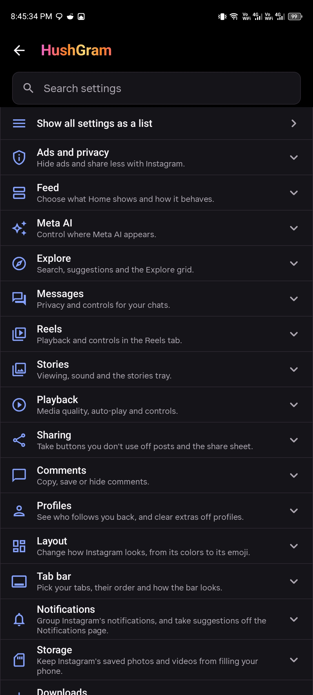
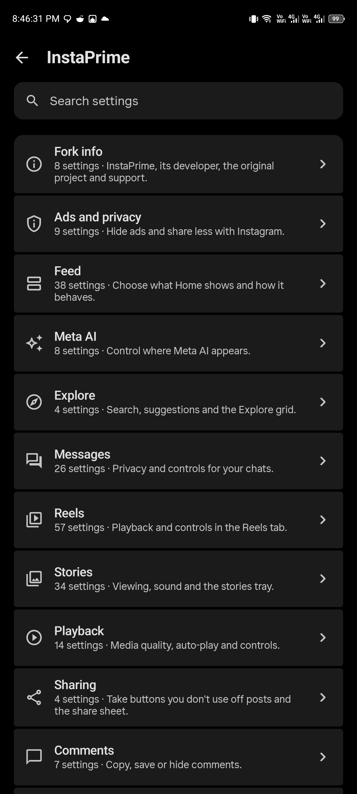
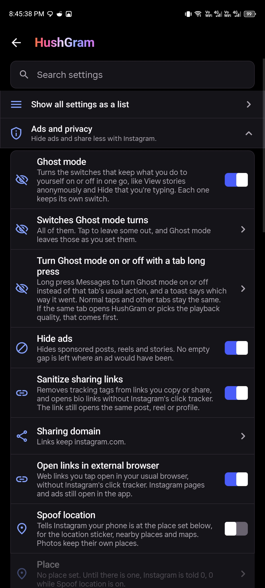
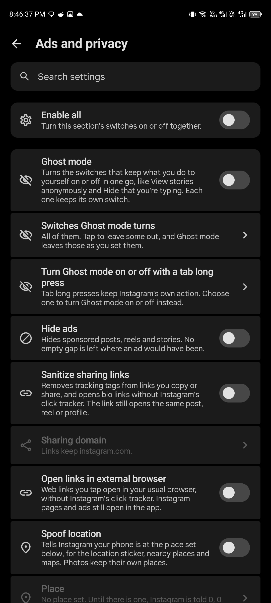
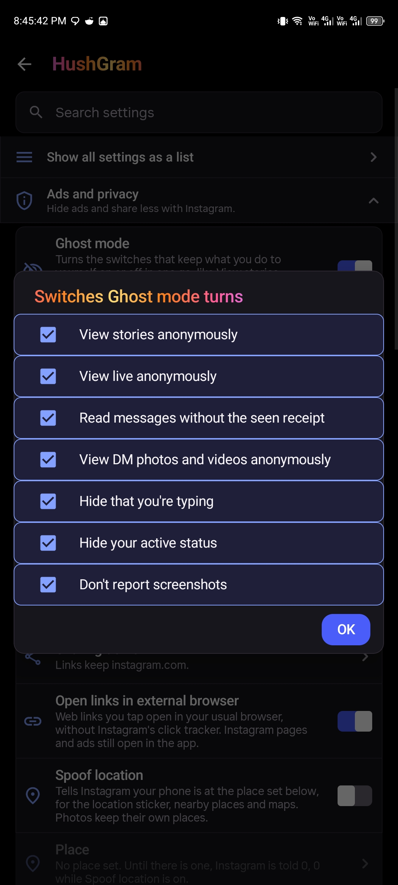
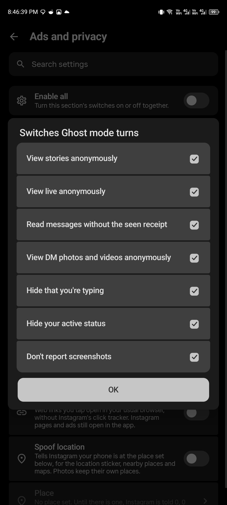
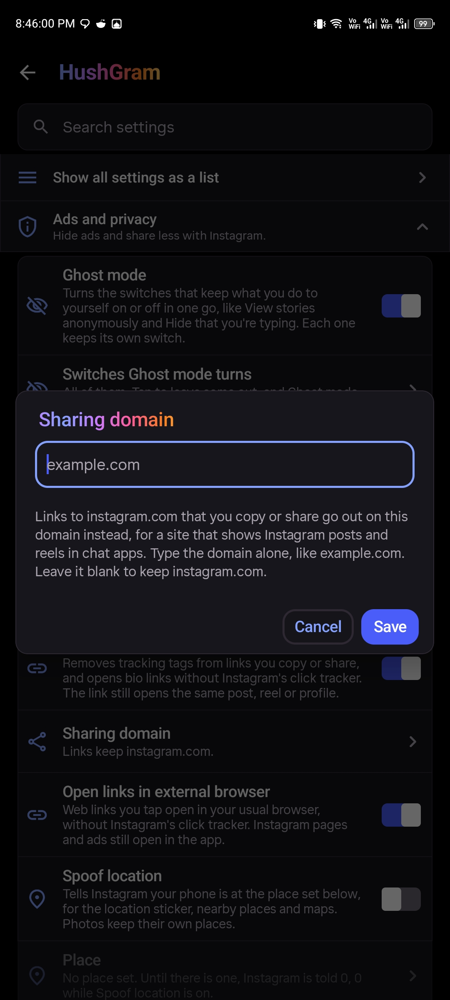
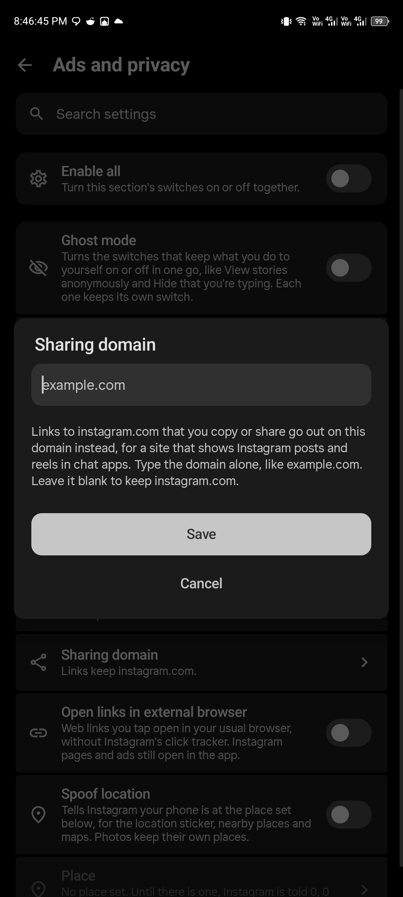

<p align="center">
  
</p>

# InstaPrime

A settings UI and branding rework of [HushGram](https://github.com/SysAdminDoc/HushGram), the Instagram patch project created by [SysAdminDoc](https://github.com/SysAdminDoc).

**The Instagram patches, their underlying functionality, research, compatibility work, and ongoing upstream maintenance are the work of SysAdminDoc and the upstream contributors. This fork does not claim credit for that work.**

> I made this fork to rework the settings interface and give it the InstaPrime name and icon. I do not claim authorship of HushGram's patches or the work that keeps them working as Instagram changes. That credit belongs to the original creator, SysAdminDoc, and the contributors credited by the upstream project.
>
> — [FarhanZafarr-9](https://github.com/FarhanZafarr-9)

[Original project](https://github.com/SysAdminDoc/HushGram) · [Original creator](https://github.com/SysAdminDoc) · [Support the original creator](https://ko-fi.com/X8K126YVER) · [Upstream guide](docs/upstream/README.md) · [License](LICENSE) · [Notices and attribution](NOTICE)

## What this fork changes

InstaPrime builds on HushGram's existing settings and patch infrastructure. Its changes focus on how those settings are presented and used:

- **Category navigation:** the settings home shows category rows that open their own pages. Larger categories have another level of grouping, with a back action and restored scroll positions.
- **Row layout:** borderless grouped rows, rounded corners, more horizontal padding, space below search and at the bottom, and fully readable descriptions. Ripples stay inside the visible row.
- **Settings colors:** wallpaper-derived Material tones on Android 12 and newer, with fallback colors on older Android versions. This describes the settings interface; it does not add wallpaper-colored backgrounds throughout Instagram.
- **Switches:** rounded tracks and circular thumbs, an on-state checkmark, animations that survive row replacement, and clearer disabled states. Temporarily unavailable options retain their saved choices.
- **Dialogs:** rounded selection indicators, tonal backgrounds for selected and unselected choices, borderless text fields, vertically stacked full-width actions, and a redesigned restart notice.
- **Section controls:** an **Enable all** switch on pages containing direct toggle options, respecting each option's availability and validation. Category pages containing further subcategories do not show it.
- **Fork information:** a section at the top with this fork's details, the original project and creator, licenses, reporting, and upstream support links.
- **Branding:** the InstaPrime name and rounded camera icon in the settings entry, shortcut, launcher option, launch screen, and optional clone badge. The clone defaults to `InstaPrime` with package `com.instagram.android.prime`.

The Instagram features exposed by these settings come from HushGram. Reorganizing their controls does not make them new patches created by this fork. Existing setting keys and the backup format are retained for compatibility.

## Before and after

Left: the original HushGram interface. Right: the InstaPrime rework. These captures compare presentation; different switch positions in the images are not changes to feature ownership or proof of changed defaults.

### Category navigation

| HushGram — original | InstaPrime — rework |
| --- | --- |
|  |  |

### Settings rows and switches

| HushGram — original | InstaPrime — rework |
| --- | --- |
|  |  |

### Selectable options

| HushGram — original | InstaPrime — rework |
| --- | --- |
|  |  |

### Text-entry dialogs

| HushGram — original | InstaPrime — rework |
| --- | --- |
|  |  |

The original screenshot files are kept in [docs/screenshots/settings](docs/screenshots/settings).

## Patches and compatibility

This fork is based on HushGram **0.0.17**, whose catalog contains **123 patches** for Instagram. Features such as ad hiding, privacy controls, downloads, playback controls, and tab bar customization are inherited from upstream.

| Item | Base supported by this fork |
| --- | --- |
| Android | Android 9 / API 28 or newer |
| Instagram package | `com.instagram.android` |
| Instagram version | `453.0.0.55.79` |
| arm64-v8a build | `385914283` |
| armeabi-v7a build | `385914282` |
| x86 / x86_64 builds | `385914284` / `385914285` |
| Morphe Manager | `2.2.0` or newer |

These are the inherited compatibility targets, not a claim that this fork has independently repeated every upstream device test. See the [upstream guide](docs/upstream/README.md#supported-instagram-builds) and [upstream changelog](CHANGELOG.md) for the original feature and compatibility history. The changelog records HushGram's work; the fork-specific changes are listed above.

## Install the UI rework

1. Install [Morphe Manager](https://github.com/MorpheApp/morphe-manager) 2.2.0 or newer.
2. Obtain an **InstaPrime `.mpp` bundle built from this fork**, or build one using the instructions below. A `.mpp` is a patch bundle, not an Instagram APK. An upstream HushGram bundle contains the upstream interface.
3. Add the bundle in Manager through **Sources → + → Local**. Use it as the only enabled Instagram patch source for this patch run.
4. Select a stock Instagram APK matching the version and build above, choose the patches you want, then patch and install.
5. Open **InstaPrime** at the top of Instagram's **Settings and activity**, or long-press the Instagram logo on Home. Choose a category to open its settings.

For a separate installation, select **Install next to Instagram**. This fork defaults to the label **InstaPrime** and package **`com.instagram.android.prime`**. Keep the same package name and signing key for subsequent updates.

Keep a backup of your Morphe signing key. Android requires the same key to update an existing patched installation while preserving its data. A differently signed installation may require uninstalling the existing app, which deletes its local data. See the [upstream signing-key guide](docs/upstream/README.md#keep-your-signing-key).

The original HushGram releases and patch source remain available from [SysAdminDoc/HushGram](https://github.com/SysAdminDoc/HushGram). They are maintained by the original project and should not be confused with this fork's UI build.

## Build from source

Use the upstream build prerequisites: JDK 17 or newer, the Android SDK, and a GitHub token with `read:packages` access for the Morphe patcher dependency. Supply credentials through environment variables; never put a token in source files or commit it.

```bash
export GITHUB_ACTOR="your-github-username"
export GITHUB_TOKEN="your-package-read-token"
./gradlew :patches:generatePatchesList --max-workers=1
./gradlew :patches:buildAndroid --max-workers=1
```

On Windows, set the variables using `$env:GITHUB_ACTOR` and `$env:GITHUB_TOKEN`, and run `gradlew.bat` instead of `./gradlew`.

Run the two build commands in the order shown. The bundle is written to `patches/build/release/patches-<version>.mpp`, alongside build verification artifacts. The documentation screenshots live outside that generated build directory so a clean build will not remove them.

The focused settings checks used for this rework are:

```bash
./gradlew :extensions:instagram:testDebugUnitTest --tests 'app.hushgram.extension.instagram.settings.SettingsCardsTest' --max-workers=1
```

The latest local run passed **44 settings tests** across Android API 28 and 37, including navigation, selection behavior, animation across row replacement, dependent options, and rendered disabled-switch contrast. The generated bundle also passed its integrity checks for 123 patches and all three non-empty DEX payloads. These checks do not replace testing a patched APK on your own device.

For the full upstream build workflow, fixture-based patch tests, and release checks, see the [upstream build guide](docs/upstream/README.md#building-from-source) and [CONTRIBUTING.md](CONTRIBUTING.md).

## Reporting problems

Report issues with this fork's settings navigation, visuals, switches, dialogs, or branding in [this fork's issue tracker](https://github.com/FarhanZafarr-9/HushGram/issues).

For an underlying patch problem, first check whether it also happens with the original HushGram build. If it does, follow the [upstream reporting guide](docs/upstream/README.md#getting-help), identify the build you used, and include the requested diagnostics. Please do not ask the original creator to support changes specific to this fork.

## Credits and support

**SysAdminDoc deserves the credit for creating HushGram and for the continuing research, development, testing, compatibility updates, and maintenance behind its patches.** The upstream contributors and the projects HushGram builds on retain their own authorship and attribution.

FarhanZafarr-9's contribution here is the settings UI rework, navigation and control presentation, fork documentation, and InstaPrime branding described in this README. This is a derivative UI fork, not a claim to have created the patch collection. The separate name identifies the fork and does not imply endorsement by SysAdminDoc.

If the patches are useful to you, please [support the original creator on Ko-fi](https://ko-fi.com/X8K126YVER) and visit the [original project](https://github.com/SysAdminDoc/HushGram).

HushGram also carries work and foundations from Hushfacebook, Hushfeed, HushPinterest, Andrew Liang's patches, Morphe, ReVanced, and other credited contributors. The [upstream attribution section](docs/upstream/README.md#where-the-patches-come-from), [source ledger](sources/instagram-sources.json), and [NOTICE](NOTICE) preserve that provenance. The original notices and copyright headers remain in place.

## License

[GNU GPL v3](LICENSE), with the additional notices and requirements reproduced in [NOTICE](NOTICE). The fork retains the upstream license and attribution.

InstaPrime is not affiliated with or endorsed by Meta, Instagram, Morphe, or the original HushGram creator. Instagram and Meta are trademarks of Meta Platforms, Inc. Modified clients remain subject to Instagram's rules and account restrictions; the [upstream account-risk guidance](docs/upstream/README.md#before-you-sign-in) still applies.
